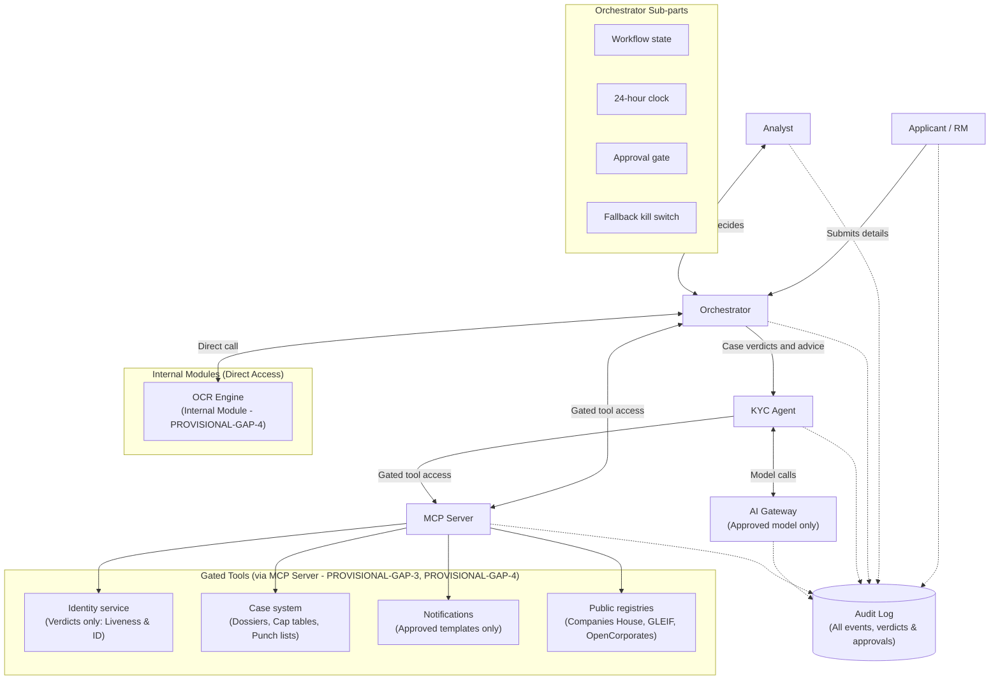

# Project Northgate: System Architecture

**Document Version:** 1.2.0 (Provisional Defaults & Four-Tool MCP Alignment)  
**Associated Diagram:** `docs/architecture.png` *(Place diagram image at this path)*  
**System Classification:** Mission-Critical Compliance Orchestration & Agentic KYC System  

---

## 1. Architecture Diagram Reference

*Figure 1: Project Northgate target architecture diagram showing end-to-end interactions between the Applicant, Analyst, Orchestrator, KYC Agent, AI Gateway, MCP Server, Gated Tools, and Audit Log.*

---

## 2. Components & Sub-Parts

The architecture comprises seven primary components, with specialized sub-parts inside the Orchestrator, an internal OCR module, and four gated tools hosted behind the Model Context Protocol (MCP) server:

1. **Applicant:**  
   The external commercial entity or authorized representative submitting onboarding packages, corporate formation documents, and natural person UBO credentials directly or via assisted Relationship Manager (RM) channels. (Note: Dedicated individual UBO asynchronous invitation channel is deferred per PROVISIONAL-GAP-7).
2. **Analyst:**  
   The human compliance officer and KYC investigator (e.g., Marcus Vance) responsible for reviewing complex cases, assessing risk discrepancies, overriding classifications with mandatory justification, and providing formal approvals or final rejection decisions.
3. **Orchestrator:**  
   The central workflow execution engine coordinating lifecycle transitions, enforcing regulatory timing, and governing communications. It contains four critical sub-parts:
   - **Workflow state:** Maintains the authoritative finite state machine (FSM) of each case (e.g., Ingested, In Review, Deficient, Blocked, Approved, Rejected).
   - **24-hour clock:** Tracks statutory and operational service level agreements (SLAs), issuing escalations and warnings (at T+12h, T+18h, T+22h) as cases approach deadline thresholds.
   - **Approval gate:** A deterministic enforcement barrier ensuring no risky, externally visible action, sensitive state transition, or account activation occurs without explicit human analyst sign-off.
     - *Exception (PROVISIONAL-GAP-6):* Automated biometric re-take prompts using approved templates bypass the approval gate only when they contain no case-specific risk content.
   - **Fallback kill switch:** An automated circuit breaker and emergency stop mechanism that safely halts automated agentic operations and routes cases to manual fallbacks upon gateway outages, tool failures, or anomaly detection.
4. **KYC Agent:**  
   The intelligent reasoning agent tasked with evaluating corporate structures, cross-referencing case records, computing beneficial ownership, and synthesizing case verdicts and actionable advice for the Orchestrator.
5. **AI Gateway (Approved Model Only):**  
   The strictly controlled proxy and governance perimeter governing all model interactions (PROVISIONAL-GAP-2). It enforces model whitelist policies, rate limits, prompt hygiene, and full audit capture, ensuring only enterprise-approved foundation models are invoked. Every output must pass JSON schema validation (PROVISIONAL-GAP-9).
6. **Internal OCR Module:**  
   An internal document processing module outside the MCP server (PROVISIONAL-GAP-4) providing OCR extraction and bounding box coordinates for uploaded evidentiary documents.
7. **MCP Server (Model Context Protocol):**  
   The standardized tool integration layer that brokers gated tool access for both the Orchestrator and the KYC Agent (PROVISIONAL-GAP-3). It exposes four gated tools:
   - **Identity service:** Encapsulates individual identity document and biometric liveness checks (PROVISIONAL-GAP-1), returning strictly normalized pass/fail/discrepancy verdicts.
   - **Case system:** The system of record storing case files, OCR bounding boxes, cap tables, entity dossiers, and deficiency punch lists.
   - **Notifications:** Outbound dispatch channel operating strictly on pre-approved compliance templates for RM and applicant outreach.
   - **Public registries:** (PROVISIONAL-GAP-4) The fourth gated MCP tool covering official registry queries (UK Companies House, GLEIF LEI lookup, and OpenCorporates), returning official registry fields and fixtures.
8. **Audit Log:**  
   The centralized, immutable audit repository recording every event, model invocation, gated tool call, verdict, analyst decision, and approval in SEC 17a-4 / FINRA compliant WORM storage with SHA-256 Merkle chain verification.

---

## 3. System Connections & Data Flow

* **Applicant $\rightarrow$ Orchestrator:** The Applicant (or Relationship Manager) submits onboarding packages, corporate formation documents, and personal details into the Orchestrator intake endpoint.
* **Analyst $\leftrightarrow$ Orchestrator:** Bi-directional decisioning channel. The Orchestrator presents triage queues, discrepancy punch lists, and agent verdicts to the Analyst; the Analyst submits manual overrides, approvals, and final disposition decisions.
* **Orchestrator $\leftrightarrow$ Internal OCR Module:** The Orchestrator dispatches uploaded document bundles to the internal OCR module to obtain structured text and bounding box coordinates.
* **Orchestrator $\rightarrow$ KYC Agent:** The Orchestrator delegates ingested case payloads to the KYC Agent and receives synthesized case verdicts, discrepancy evaluations, and remediation advice.
* **KYC Agent $\leftrightarrow$ AI Gateway:** The KYC Agent executes generative and analytical model reasoning exclusively through the AI Gateway using pre-approved models with strict schema validation.
* **Orchestrator $\leftrightarrow$ MCP Server:** The Orchestrator accesses gated tools (Case system, Notifications, Public registries) through standardized MCP interfaces.
* **KYC Agent $\rightarrow$ MCP Server:** The KYC Agent consumes gated tools (Identity service, Case system, Public registries) through the MCP server.
* **MCP Server $\rightarrow$ External Services (Identity service, Case system, Notifications, Public registries):** The MCP server brokers secure requests to the respective underlying backend microservices and databases.
* **All Components $\rightarrow$ Audit Log:** Every component emits telemetry, state changes, input/output digests, and decision records directly to the Audit Log.

---

## 4. Architectural Rules

1. **Approval Gate for Outbound Communications & Activations:**  
   The Orchestrator's Approval Gate strictly blocks any risky outbound send (e.g., deficiency notices, requests for information, rejections) and account activations without explicit Analyst approval.
   - *Exception (PROVISIONAL-GAP-6):* Automated biometric re-take prompts using approved templates bypass the approval gate only when they contain no case-specific risk content. All other messages remain gated.
2. **Comprehensive Audit Immutability:**  
   All events, system state transitions, AI model prompts/responses, tool calls, verdicts, and human analyst approvals must be recorded synchronously to the immutable Audit Log.
3. **Verdict-Only Identity Service:**  
   The Identity Service returns verdicts only (e.g., `PASS`, `FAIL`, `SUSPECTED_SPOOF`, `EXPIRED_CREDENTIAL`). Raw biometric payloads, facial vectors, and sensitive biometric telemetry are never returned to or stored by the KYC Agent or Orchestrator (PROVISIONAL-GAP-8).
4. **Approved Notification Templates Only:**  
   The Notifications tool dispatches messages strictly using pre-approved, standardized regulatory templates. Free-form text generation or unapproved modifications by agents are strictly disallowed.
5. **Enforced AI Gateway Mediation & Schema Validation:**  
   All model calls must route exclusively through the AI Gateway using approved models. Every completion must pass deterministic JSON schema validation (PROVISIONAL-GAP-9). Invalid output is rejected and flagged for analyst review. Model output never sets UBO percentages (PROVISIONAL-GAP-2).
6. **MCP Server Gated Access:**  
   The Orchestrator and the KYC Agent must reach external enterprise systems (Identity, Case System, Notifications, Public registries) solely through the MCP Server. (Exception: The OCR module is an internal module outside the MCP server per PROVISIONAL-GAP-4).

---

## 5. Failure Scenarios

### 5.1 Scenario 1: Genuine Applicant (Nominal Path)
* **Trigger:** A legitimate corporate applicant submits complete formation documents and identity records.
* **Execution Flow:**
  1. The Orchestrator ingests the dossier, initializes the workflow state (`IN_PROGRESS`), starts the 24-hour clock, and dispatches the task to the KYC Agent.
  2. The KYC Agent queries the Case System, Public registries, and Identity Service via the MCP Server and calls the AI Gateway to evaluate documents and ownership structures.
  3. The Identity Service and Public registries verify credentials and statutory filings, returning clean verdicts.
  4. The KYC Agent confirms all beneficial owners ($\ge 25\%$) are identified and verified with clean liveness checks, reporting a clean case verdict to the Orchestrator.
  5. The Orchestrator routes the completed dossier to the Analyst queue.
  6. The Analyst reviews the evidentiary trail and executes final approval.
  7. The Orchestrator passes through the Approval Gate, dispatches an approved welcome notification via the Notifications tool, marks the case `APPROVED`, and stops the 24-hour clock well within SLA targets.
  8. Every step, tool invocation, and decision is written to the Audit Log.

### 5.2 Scenario 2: Fails Liveness Check
* **Trigger:** An applicant or corporate beneficial owner submits an identity verification package, but the biometric capture fails or detects a spoof attempt.
* **Execution Flow:**
  1. The KYC Agent invokes the Identity Service tool via the MCP Server to evaluate the identity submission.
  2. The Identity Service determines that the submission fails the liveness threshold and returns a `FAIL: LIVENESS_CHECK_FAILED` verdict to the MCP Server.
  3. The KYC Agent receives the verdict, tags the entity with a critical deficiency, and advises the Orchestrator that the case is blocked.
  4. The Orchestrator transitions the workflow state to `BLOCKED_PENDING_REMEDIATION`.
  5. If the re-take message contains no case-specific risk content, an automated re-take prompt is dispatched via approved templates (PROVISIONAL-GAP-6). If risk flags or case specifics exist, the **Approval Gate** intercepts and blocks the outbound message until Analyst review.
  6. The case appears on the Analyst workbench flagged with a Critical Blocker.
  7. The Analyst reviews the audit trace, confirms the failure, and takes appropriate action.
  8. All failure verdicts, notifications, analyst decisions, and audit entries are committed to the Audit Log.

### 5.3 Scenario 3: Gateway Outage
* **Trigger:** The AI Gateway encounters an operational outage, network partition, or model provider downtime.
* **Execution Flow:**
  1. The KYC Agent initiates an inference call through the AI Gateway.
  2. The connection fails (e.g., HTTP 503, gateway timeout, or connection refused).
  3. In accordance with Rule 5, the KYC Agent retries within bounded limits and reports failure to the Orchestrator upon exhaustion.
  4. The Orchestrator triggers the **Fallback Kill Switch**, immediately pausing automated agent processing to prevent ungrounded conclusions.
  5. The Orchestrator transitions the affected cases into a `MANUAL_REVIEW_FALLBACK` state.
  6. The 24-hour clock continues running, and an urgent operational alert is dispatched to compliance engineering and analysts.
  7. Human analysts take over active cases using deterministic legacy intake tools and manual verification procedures.
  8. The outage event, triggered kill switch, and transition to manual state are logged in the Audit Log.

---

## 6. Pilot Scope Mapping

| Component / Sub-Part / Tool | Architecture Diagram | JTBD Specification | Pilot Scope Classification | Reconciliation & Scope Boundaries |
| :--- | :--- | :--- | :--- | :--- |
| **Applicant** | Present | Present | **In pilot spec** | Commercial entity submitting formation documents and identity records directly. |
| **Analyst** | Present | Present | **In pilot spec** | KYC Senior Analyst reviewing workbench, overrides, and final approvals. |
| **Orchestrator - Workflow state** | Present | Present | **In pilot spec** | Authoritative lifecycle FSM managing case states and transitions. |
| **Orchestrator - 24-hour clock** | Present | Present | **In pilot spec** | Dedicated timer service tracking the 24-hour turnaround SLA and stage alerts. |
| **Orchestrator - Approval gate** | Present | Present | **In pilot spec** | Human-in-the-loop gate blocking risky outbound sends and account activations (with Gap 6 re-take exception). |
| **Orchestrator - Fallback kill switch** | Present | Present | **In pilot spec** | Automated circuit breaker tripping on gateway outage, tool faults, or manual emergency stop. |
| **KYC Agent** | Present | Present | **In pilot spec** | Automated worker orchestrating extraction evaluation, UBO resolution, and advice. |
| **AI Gateway (Approved model only)** | Present | Present | **In pilot spec** | Enterprise proxy governing LLM model access, rate limits, and audit compliance (PROVISIONAL-GAP-2, PROVISIONAL-GAP-9). |
| **Internal OCR Module** | Added as Internal Module | Present | **In pilot spec** | Document extraction module outside MCP server (PROVISIONAL-GAP-4). |
| **MCP Server** | Present | Present | **In pilot spec** | Model Context Protocol middleware layer standardizing four gated tools (PROVISIONAL-GAP-3). |
| **Identity service (gated tool)** | Present | Present | **In pilot spec** | Encapsulates UBO liveness and ID checks returning verdicts only (PROVISIONAL-GAP-1, PROVISIONAL-GAP-8). |
| **Case system (gated tool)** | Present | Present | **In pilot spec** | Underlying datastore for cases, punch lists, bounding boxes, and cap table state. |
| **Notifications (gated tool)** | Present | Present | **In pilot spec** | Dispatch mechanism for remediation using approved templates (PROVISIONAL-GAP-6). |
| **Public registries (gated tool)** | Added as 4th Gated Tool | Present | **In pilot spec** | Fourth gated MCP tool covering Companies House, GLEIF, and OpenCorporates (PROVISIONAL-GAP-4). |
| **Audit log** | Present | Present | **In pilot spec** | SEC 17a-4 / FINRA WORM storage with SHA-256 Merkle chain verification. |
| **Liveness check (Biometric)** | Present | Present | **In pilot spec** | Scoped to individual natural persons qualifying as UBOs ($\ge 25\%$) or Authorized Signatories (PROVISIONAL-GAP-1, PROVISIONAL-GAP-5). |
| **Relationship Manager (RM)** | Depicted via Applicant channel | Present | **In pilot spec** | Front-office actor supporting assisted dossier intake and client remediation. |
