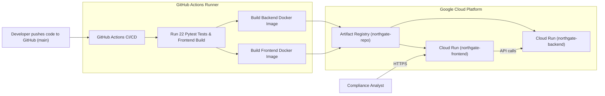

# Project Northgate — Google Cloud Platform (GCP) Deployment Guide

This guide walks you step-by-step through deploying Project Northgate to **Google Cloud Platform (GCP)** using **Docker**, **Google Cloud Run**, and **GitHub Actions CI/CD**.

> **No GCP or Docker expertise required!** Because local installation of Docker or `gcloud` is not needed, all builds, containerization, and deployments are executed in the cloud by GitHub Actions and Google Cloud Run.

---

## 1. Deployment Architecture



### Why Google Cloud Run?
- **Serverless & Zero Maintenance:** Google manages all servers, scaling, and OS updates.
- **Scale to Zero ($0 Cost when Idle):** Automatically scales instances to 0 when no requests are being processed.
- **Built-in HTTPS & Custom Domains:** Automatic TLS/SSL certificates out of the box.
- **Dual Container Separation:** Frontend (Nginx + React) and Backend (FastAPI + Python 3.13) run in isolated, secure micro-containers.

---

## 2. One-Time Setup (5 Minutes)

You can run this setup directly inside **Google Cloud Shell** (a pre-configured terminal in your web browser with `gcloud` pre-authenticated).

### Step 1: Open Google Cloud Shell
1. Log in to the [Google Cloud Console](https://console.cloud.google.com).
2. Select or create your Google Cloud Project.
3. Click the **Activate Cloud Shell** icon (`>_`) in the top-right toolbar.

### Step 2: Run the One-Click Provisioning Script
In Cloud Shell, paste and run:

```bash
# Set your project (replace with your GCP project ID if not already active)
gcloud config set project $(gcloud projects list --format="value(projectId)" --limit=1)

# Enable required GCP APIs
gcloud services enable run.googleapis.com artifactregistry.googleapis.com iam.googleapis.com cloudbuild.googleapis.com

# Create the Artifact Registry Docker repository
gcloud artifacts repositories create northgate-repo \
  --repository-format=docker \
  --location=us-central1 \
  --description="Project Northgate Docker repository"

# Create a Service Account for GitHub Actions
gcloud iam service-accounts create github-actions-northgate \
  --display-name="GitHub Actions Deployer"

# Assign required deployment roles
PROJECT_ID=$(gcloud config get-value project)
SA_EMAIL="github-actions-northgate@${PROJECT_ID}.iam.gserviceaccount.com"

gcloud projects add-iam-policy-binding $PROJECT_ID --member="serviceAccount:$SA_EMAIL" --role="roles/run.admin"
gcloud projects add-iam-policy-binding $PROJECT_ID --member="serviceAccount:$SA_EMAIL" --role="roles/artifactregistry.writer"
gcloud projects add-iam-policy-binding $PROJECT_ID --member="serviceAccount:$SA_EMAIL" --role="roles/iam.serviceAccountUser"

# Generate the deployment key
gcloud iam service-accounts keys create gcp-key.json --iam-account=$SA_EMAIL

# Display the key to copy to GitHub
cat gcp-key.json
```

---

## 3. Configure GitHub Repository

### Step 1: Add the Secret to GitHub
1. Open your GitHub repository in your web browser.
2. Navigate to **Settings** $\to$ **Secrets and variables** $\to$ **Actions**.
3. Click the green button: **New repository secret**.
4. Configure:
   - **Name:** `GCP_SA_KEY`
   - **Secret:** Paste the entire JSON output from `cat gcp-key.json` above.
5. Click **Add secret**.

---

## 4. Trigger Automatic Deployment

Every time you push to the `main` branch, the [`.github/workflows/deploy.yml`](../.github/workflows/deploy.yml) workflow runs automatically:

1. **Automated Testing:** Runs backend pytest suite (all 22 compliance and failure tests) and frontend build check.
2. **Container Build:** Compiles the Docker images for Backend and Frontend.
3. **Artifact Registry Push:** Tags and pushes both images to GCP.
4. **Cloud Run Deployment:**
   - Deploys `northgate-backend` to Cloud Run.
   - Captures the backend URL (e.g., `https://northgate-backend-xyz.a.run.app`).
   - Injects the URL into the Frontend build.
   - Deploys `northgate-frontend` to Cloud Run (e.g., `https://northgate-frontend-xyz.a.run.app`).
5. **Live Links:** Outputs the live URLs directly into the GitHub Actions run summary!

---

## 5. Local Docker Testing (Optional)

If you have Docker Desktop installed on your local computer, you can run the entire stack locally with Docker Compose:

```bash
docker compose up --build
```

- **Frontend:** [http://localhost:3000](http://localhost:3000)
- **Backend API Docs:** [http://localhost:8000/docs](http://localhost:8000/docs)
- **Backend Health:** [http://localhost:8000/health](http://localhost:8000/health)

---

## 6. Verification Checklist

| Service | Cloud Run Service | Port | Health Check |
| :--- | :--- | :--- | :--- |
| **Frontend UI** | `northgate-frontend` | 8080 | `GET /health` |
| **Backend Compliance Engine** | `northgate-backend` | 8080 | `GET /health` |
| **Artifact Storage** | `northgate-repo` (Artifact Registry) | - | - |
| **Audit Log Integrity** | Ingested via Backend | - | `GET /api/audit/verify` |
